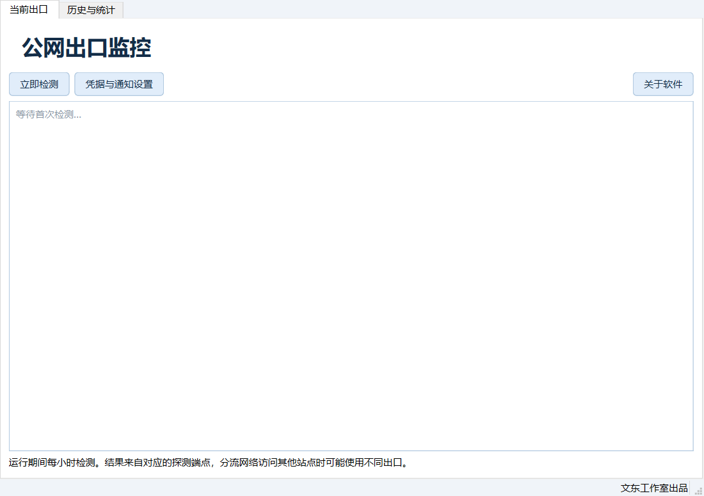

# IP Sentinel — 公网出口 IP 纯净度检测与监控工具

文东工作室出品。当前版本为 **V1.2.0**。

IP Sentinel 是 Windows 桌面工具，用于查看本机访问探测服务时的公网出口、记录地址变化，并向配置的渠道发送告警。适用于家庭宽带、办公网络以及需要核对代理分流的场景。IPv4 和 IPv6 分别检测，不同网站可能因分流使用不同出口。

## 功能

- 查看公网 IPv4、IPv6，以及国家、地区、ASN 和运营商等归属信息。
- 启动时立即检测，运行期间每小时检测，也可手动执行。地址按协议建立基线，失败不会丢失上一次有效基线。
- 在本机匹配 Tor 出口、已知 VPN 网段和机房或 VPN 混合网段。公开名单无需 API 密钥，每 12 小时尝试后台刷新，失败时沿用有效缓存。可选的 IPWhois Pro 安全标签独立显示。
- 在 Windows 托盘运行，记录 IP 变化并向 Windows 通知区域、Telegram 或企业微信群机器人发送告警。
- 将历史保存在本地 SQLite。可按 IP 查询、查看单条证据及导出 UTF-8 CSV。

「该名单未收录」仅表示该来源没有匹配记录。混合名单命中不能单独证实地址属于机房或 VPN。缺少证据的字段显示「未知」。

## 界面



## 系统要求与安装

支持 Windows 10 1809 及以上版本和 Windows 11（x64）。安装版按当前用户安装，默认无需管理员权限。安装版和便携版均自带运行依赖，无需另装 Python。本仓库提供源码与构建说明。

- **安装版**：取得 `IPSentinel_Setup_v1.2.0.exe` 后运行中文向导。保留「创建桌面快捷方式」的勾选可直接从桌面启动。开始菜单也有用户手册入口。
- **便携版**：完整解压 `IPSentinel_Portable_v1.2.0.zip`，从解压后的目录启动 `IP Sentinel.exe`，并保留同目录下的 `_internal`。
- **升级或卸载**：先从系统托盘退出旧程序。安装版可覆盖升级，也可在 Windows 应用设置里卸载。卸载会保留历史和凭据。同一台机器、同一 Windows 账户下，安装版和便携版共用这些本地数据。

## 使用与配置

1. 打开「当前出口」查看结果，或点击「立即检测」。首次使用等后台名单下载后，可再次检测以查看名单证据。
2. 在「历史与统计」里按 IP 查询，双击记录查看详情，或导出当前查询的 CSV。
3. 如需远程告警，打开「凭据与通知设置」，按所用渠道配置并保存。

| 渠道 | 配置 |
| --- | --- |
| Telegram | 同时填写 Bot Token 和 Chat ID。群组 ID 若以负号开头，请保留负号。 |
| 企业微信 | 填写企业微信群机器人的完整 HTTPS Webhook。该渠道适用于企业微信群。 |
| IPWhois Pro | 可选的第三方收费情报接口。需要安全标签时应选含 Security Data 的套餐。 |

首条有效检测只建立基线，同一协议随后检测到不同出口才触发变化告警。各渠道本次发送结果显示在状态栏。[Telegram Bot API](https://core.telegram.org/bots/api#sendmessage) · [企业微信群机器人文档](https://developer.work.weixin.qq.com/document/path/91770) · [IPWhois 官方价目表](https://ipwhois.io/pricing)

详细步骤见 [IP Sentinel V1.2.0 用户使用手册](docs/IP_Sentinel_V1.2.0_用户使用手册.docx)。

## 隐私与安全

历史位于 `%LOCALAPPDATA%\IP Sentinel\history.sqlite3`。通知凭据保存在当前用户的 Windows 凭据管理器。探测服务可以看到连接的出口地址，归属服务会收到待查询的公网 IP。免费风险检测从公开来源下载名单并在本机匹配，名单请求不包含待查 IP 或机器人凭据。外部告警启用后，旧、新公网 IP 等变更信息会发送至配置的目标。

请勿在公开问题、截图、CSV 或日志中附带真实地址、凭据或完整 Webhook。[安全说明](SECURITY.md) · [风险名单许可](docs/风险名单许可.txt)

## 开发与构建

项目使用 Python、PySide6、HTTPX、SQLAlchemy、SQLite、APScheduler 和 keyring。Windows 构建使用 x64 Python 3.12、PyInstaller 与 Inno Setup 6.7.4。以下命令在项目根目录运行，按本机情况替换 `ISCC.exe` 路径。

```powershell
python -m venv .venv
.\.venv\Scripts\python.exe -m pip install -r requirements-build.txt
.\.venv\Scripts\python.exe -m unittest discover -s tests -v
.\.venv\Scripts\python.exe main.py --smoke-test
.\packaging\build.ps1 -Python .\.venv\Scripts\python.exe -Iscc "C:\Program Files (x86)\Inno Setup 6\ISCC.exe"
```

程序源码在 `ip_sentinel/`，测试在 `tests/`。单元测试使用隔离数据库和模拟 HTTP 响应。正常启动会连接探测服务。本地构建产物位于 `dist/` 和 `release/`。使用带 python-docx 的环境运行 `docs/generate_manual.py` 可重新生成手册。

## 版本与许可证

[变更记录](CHANGELOG.md)。项目出品方为 **文东工作室**，项目整体许可证待定。仓库所附第三方组件和数据源声明继续适用。
